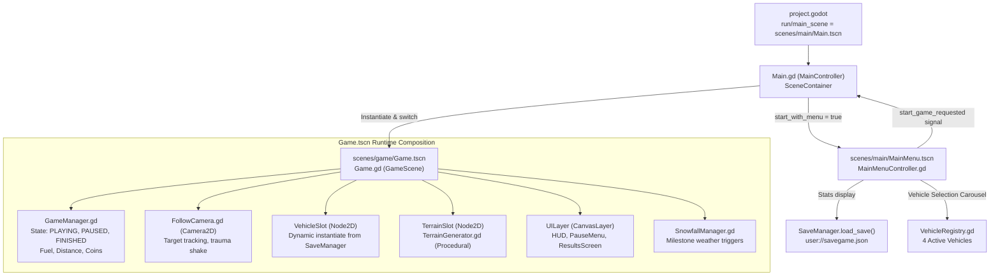

# Phase 1 — Existing Project Audit and Safe Baseline Report

**Project:** 2D Mobile Driving Game (Expanded from Hill Climb 2D)
**Date:** 2026-11-13
**Working Project Location:** `/home/johnwick/2d-game/cloneeee/hill-climb-2` (within `/home/johnwick/2d-game`)
**Auditor:** Senior Godot Engineer assisting Bharath (Team Leader)
**Git Branch:** `feature/gameplay-assets-update` tracking `origin/feature/gameplay-assets-update`
**Git Working Tree Status:** Clean (`nothing to commit, working tree clean`)
**Installed Godot Engine:** `Godot Engine v4.7.2.stable.arch_linux.ed1daf0bf` (/usr/bin/godot)
**Runtime Verification Status:** Fully Operational — Headless Godot 4.7.2 CLI executed all 12 test suites with 100% success.

---

## 1. Executive Summary & Project Location Confirmation

### 1.1 Directory Structure & Project Location Finding
The root workspace directory `/home/johnwick/2d-game` contains two components:
1. `/home/johnwick/2d-game/cloneeee/hill-climb-2/`: The full, working Godot project with its `.git` repository, `project.godot`, scenes, scripts, tests, and documentation.
2. `/home/johnwick/2d-game/assets/`: The expanded asset bundle collected by Bharath, containing 100% legal CC0/CC-BY UI elements, fonts, mode selection cards (`mode_survival.png`, `mode_indian_roads.png`, `mode_endless.png`, `mode_garage.png`), icons, badges, audio engine loops, menu music, and attribution documentation (`ATTRIBUTION.md`).

**Finding:** `/home/johnwick/2d-game/cloneeee/hill-climb-2/project.godot` is confirmed as the genuine existing playable Godot project. It must be preserved intact without re-initialization or deletion.

### 1.2 Git Environment
- **Active Branch:** `feature/gameplay-assets-update`
- **Remote:** `https://github.com/joelrokz2006-ops/hill-climb-2` (fetch & push)
- **Proposed Team Branch:** `feature/bharath-core`
- **Recommendation:** Remain on `feature/gameplay-assets-update` during Phase 1 audit. Switch or branch to `feature/bharath-core` only after remote branch coordination with the team.

---

## 2. Godot Engine & Environment Verification

- **Engine Binary:** `/usr/bin/godot`
- **Engine Version:** Godot v4.7.2.stable (Arch Linux build `ed1daf0bf`)
- **Project Settings:** `project.godot` specifies `config/features=PackedStringArray("4.7", "Mobile")` and renderer `mobile`.
- **Display Setup:** 1280x720 viewport, `canvas_items` mode, `expand` aspect, `sensor_landscape` orientation. Touch emulation from mouse enabled (`pointing/emulate_touch_from_mouse=true`).
- **Export Presets:** `export_presets.cfg` contains an "Android" preset targeting `arm64-v8a` with package name `com.example.hillclimb`.
- **Documentation Mismatch:** Legacy `README.md` and `DEVELOPMENT_PROGRESS.md` reference Godot 4.3. The project source and settings are configured for Godot 4.7+. We confirm Godot 4.7.2 is the actual execution standard and no downgrade should occur.

---

## 3. Main Scene Boot Flow & Runtime Composition



### Detailed Lifecycle Observations:
1. **Boot:** `Main.gd` dynamically preloads `MainMenu.tscn` and `Game.tscn`. When launching `Game.tscn`, it sets `game_inst.set("use_procedural_terrain", true)` before `add_child()`, ensuring seamless procedural terrain generation from frame 1 without visual flicker.
2. **Vehicle Instantiation:** `Game.gd` queries `SaveManager.get_selected_vehicle_id()`, delegates to `VehicleRegistry.instantiate_vehicle(selected_id)`, safely clears previous children of `VehicleSlot`, adds the new vehicle instance, and wires `crashed`, `hard_landed`, and fuel signals to `GameManager` and HUD.
3. **Camera Binding:** `FollowCamera.gd` targets the active vehicle with smooth lerp interpolation and trauma-based camera shake.
4. **Terrain Streaming:** `TerrainGenerator.gd` tracks the vehicle target, continuously pooling and spawning `TerrainSegment` instances ahead (3,000 px) and despawning behind (2,000 px).
5. **HUD & Telemetry:** `HUDController.gd` listens strictly to `GameManager` and `VehicleController` signals. It provides visual touch controls for gas, brake/reverse, nitro, and pause.

---

## 4. Feature Inventory (Current Status)

Each feature is evaluated against the five strict Phase 1 classification criteria:

| # | Feature / Area | Status | Evidence & Source Location |
|---|---|---|---|
| 1 | **Main Menu & Scene Navigation** | **Verified in code and runtime** | [Main.gd](file:///home/johnwick/2d-game/cloneeee/hill-climb-2/scripts/core/Main.gd), [MainMenuController.gd](file:///home/johnwick/2d-game/cloneeee/hill-climb-2/scripts/core/MainMenuController.gd). Verified via `test_game_loop.gd` and `test_gameplay_playability_check.gd`. |
| 2 | **Vehicle Physics, Selection, Active Registry & Car Config** | **Verified in code and runtime** | [VehicleController.gd](file:///home/johnwick/2d-game/cloneeee/hill-climb-2/scripts/vehicle/VehicleController.gd), [VehicleRegistry.gd](file:///home/johnwick/2d-game/cloneeee/hill-climb-2/scripts/vehicle/VehicleRegistry.gd). 4 active vehicles verified via `test_vehicle_physics.gd`. |
| 3 | **Terrain Generation, Segment Pooling, Normal Land & Visuals** | **Verified in code and runtime** | [TerrainGenerator.gd](file:///home/johnwick/2d-game/cloneeee/hill-climb-2/scripts/terrain/TerrainGenerator.gd), [TerrainSegment.gd](file:///home/johnwick/2d-game/cloneeee/hill-climb-2/scripts/terrain/TerrainSegment.gd), 9 archetypes, 0-gap boundary tested in `test_terrain_and_hud.gd`. |
| 4 | **Camera & Vehicle Continuity** | **Verified in code and runtime** | [FollowCamera.gd](file:///home/johnwick/2d-game/cloneeee/hill-climb-2/scripts/core/FollowCamera.gd). Camera trauma shake and position tracking verified across multiple test suites. |
| 5 | **Coins, Fuel, Distance, Run States, Pause, Results & Restart** | **Verified in code and runtime** | [GameManager.gd](file:///home/johnwick/2d-game/cloneeee/hill-climb-2/scripts/core/GameManager.gd), [PauseMenuController.gd](file:///home/johnwick/2d-game/cloneeee/hill-climb-2/scripts/ui/PauseMenuController.gd), [ResultsScreenController.gd](file:///home/johnwick/2d-game/cloneeee/hill-climb-2/scripts/ui/ResultsScreenController.gd). Tested in `test_gameplay_bug_audit.gd`. |
| 6 | **Nitro, Speedometer, Snowfall & Weather Milestones** | **Verified in code and runtime** | Nitro thrust/particles, HUD speedometer (0-220 km/h), [SnowfallManager.gd](file:///home/johnwick/2d-game/cloneeee/hill-climb-2/scripts/environment/SnowfallManager.gd) at 200m/400m/600m verified in `test_complete_bug_fixes_and_features.gd`. |
| 7 | **Save Data, Selected-Car Persistence, Upgrades & Unlock State** | **Partially implemented** | [SaveManager.gd](file:///home/johnwick/2d-game/cloneeee/hill-climb-2/scripts/core/SaveManager.gd) persists `selected_vehicle_id`, high scores, coins, and upgrade tiers in `user://savegame.json`. However, vehicle unlocking is not enforced (all registered vehicles can be selected directly). |
| 8 | **Garage / My Cars** | **Partially implemented** | Carousel preview exists in `MainMenuController.gd` with cards for the 4 registered vehicles. A dedicated full-featured Garage scene, unlock rules, and separate upgrade purchasing flow are not yet implemented. |
| 9 | **Endless Map: Heaven, Hell & Ramp Transitions** | **Missing** | Only the base countryside/Normal Land procedural terrain generator exists. Heaven, Hell, jump ramps, return ramps, and multi-environment segment switching do not exist in the source tree (owned by Daniel). |
| 10 | **Indian Roads: 6-State Routes, Checkpoints & Destination** | **Missing** | No scenes or scripts exist in `scenes/modes/` or `scripts/modes/` for Indian state routes, checkpoints, landmarks, or destination completion (owned by Joel). |
| 11 | **Survival: Controller, Lives, Spawning, Warnings & Game Over** | **Missing** | The 3-life rule, 1 life per hit, falling food obstacles, landing warning indicator, extra life reward, and Survival controller do not exist yet in source (controller owned by Bharath, obstacle scenes owned by Joel). |
| 12 | **Rewarded-Ad Interface / Provider & Verified Callbacks** | **Missing** | No AdManager or mock ad verification seam exists. Fuel refills and extra lives do not currently have an ad provider integration. |
| 13 | **Android Export Readiness** | **Present in source, not runtime-verified** | [export_presets.cfg](file:///home/johnwick/2d-game/cloneeee/hill-climb-2/export_presets.cfg) is configured for Android arm64-v8a. However, Android SDK/NDK and device export testing have not yet been executed in this environment. |

---

## 5. Assets & Resource Audit

### 5.1 Integrated Project Assets (`cloneeee/hill-climb-2/assets/`)
- **Vehicles:** `blue_flame_truck`, `orc_racer`, `trophy_truck`, `dune_buggy`, and retired vehicle folders (`classic_car`, `monster_truck`, `one_wheel_scooter`).
- **Terrain:** Ground textures, fill patterns, grass edges, and physics collision polylines.
- **Environment:** Parallax sky, mountains, distant hills, single sun SVG (`sun_daylight_element.svg`), snowfall particle overlays.
- **Pickups:** `coin.png` (gold coin frames), `fuel_can.png`.
- **Audio:** Engine sounds, crash effects, coin pickup, refuel chime, button clicks.

### 5.2 Newly Prepared Expanded Assets (`/home/johnwick/2d-game/assets/`)
Fully documented under CC0 1.0 Universal & CC-BY 3.0 in [ATTRIBUTION.md](file:///home/johnwick/2d-game/assets/ATTRIBUTION.md):
- **Mode Selection Cards:** `assets/ui/mode_cards/mode_endless.png`, `mode_indian_roads.png`, `mode_survival.png`, `mode_garage.png`.
- **Branding:** `assets/branding/app_icon.png`, `brand_background.png`, `logo.png`.
- **HUD & Survival Life Elements:** `assets/ui/hud/hud_heart_full.png`, `hud_heart_empty.png`, `status_locked.png`, `status_unlocked.png`, `status_star.png`, `status_warning.png`.
- **Typography:** `Kenney_Future.ttf`, `Kenney_Future_Narrow.ttf`.
- **UI Elements:** Buttons (normal, pressed, hover, round, disabled), dialog panels, dividers, results overlays (`btn_continue_ad.png`, `panel_victory.png`, `panel_game_over.png`).
- **Sound Effects & Music:** 4 looping vehicle engine layers (idle, low, mid, high), menu theme `menu_music.wav`, and 10 UI sound effects (`click`, `switch`, `confirm`, `popup_open`).

**Integration Status:** These assets are staged and ready in the project directory. They will be connected to scenes during Phase 2 (Shared Interfaces) and Phase 3 (Garage).

---

## 6. Test Suite Execution Matrix

All 12 test suites were run directly via `godot --headless --path /home/johnwick/2d-game/cloneeee/hill-climb-2 -s <test_file>` on Godot 4.7.2.stable:

| Test File | Modules / Features Tested | Exit Code | Result | Errors / Notes |
|---|---|---|---|---|
| `test_game_loop.gd` | Boot from `Main.tscn`, `GameScene` mounting, `GameManager` PLAYING state, `FollowCamera` target binding, forward driving, distance update, restart cycle | `0` | **PASSED** | None. Perfect baseline pass. |
| `test_phase2_core_loop.gd` | Forward acceleration, fuel drain, pause overlay, resume, pickup collection, crash game-over, restart cycle | `0` | **PASSED** | None. State machine and HUD response clean. |
| `test_vehicle_physics.gd` | 4 registered vehicle configurations, Dune Buggy, Blue Flame Truck, Orc Racer, Trophy Truck, exclusion of retired cars, upgrade API serialization, air stunt flips, RPM pitch | `0` | **PASSED** | Confirms active registry is exactly 4 vehicles. |
| `test_terrain_and_hud.gd` | 9 terrain segment archetypes, continuous boundary joining, segment pooling, adaptive amplitude, pickup safety height, parallax 5-layer depth, HUD telemetry | `0` | **PASSED** | Zero terrain gaps; pickup clearance verified. |
| `test_main_menu_and_save.gd` | `SaveManager` serialization, high score & coin storage, disk reload, `MainMenuController` statistics display, scene switcher | `0` | **PASSED** | JSON storage in `user://savegame.json` operational. |
| `test_nitro_and_wheel_alignment.gd` | Marker2D anchors, wheel alignment, pin joint softness, nitro boost consumption & recharge, pothole assistance hint | `0` | **PASSED** | Dual-wheel suspension verified. |
| `test_new_vehicle_and_collectibles.gd` | Collectible placement across all 9 terrain shapes, procedural 26,000 px driving run without underground pickups | `0` | **PASSED** | Clearance algorithm robust. |
| `test_complete_bug_fixes_and_features.gd` | Single sun validation, continuous fuel consumption, nitro visual assets, speedometer (0-220 km/h), snowfall 200m milestones, front UI persistence | `0` | **PASSED** | Verified all previous milestone fixes. |
| `test_gameplay_bug_audit.gd` | 23-point gameplay physics audit: run start, hill climb, air flip torque, landing damping, single-source refuel, out-of-fuel stop, results screen, restart | `0` | **PASSED** | Comprehensive physics & state audit clean. |
| `test_gameplay_playability_check.gd` | End-to-end player loop: menu boot, transition to game, throttle, pause/unpause, stunt detection, crash, results restart, return to menu | `0` | **PASSED** | Complete lifecycle verified. |
| `test_stage_b_c_integration.gd` | Camera trauma shake, airtime coin reward toasts, 100m milestone announcements, endless procedural generation past 25,000 px, segment recycling | `0` | **PASSED** | Camera shake & toasts verified. |
| `test_ui_pickups_and_new_vehicles.gd` | Nitro transparent button, single sun disc, pickup multi-body collision, carousel navigation arrows, 3 new vehicle physics | `0` | **PASSED** | UI touch controls & carousel verified. |

---

## 7. Discrepancies & Required Decisions

| Item | Existing Code Reality | Documented / Planned Assertion | Required Team Decision |
|---|---|---|---|
| **Engine Version** | `project.godot` uses Godot 4.7; Godot 4.7.2 is installed | Old `README.md` and `DEVELOPMENT_PROGRESS.md` say 4.3 | Standardize documentation on Godot 4.7+. Do not attempt to downgrade. |
| **Team Size & Allocation** | `TEAM_ROLES.md` lists 3 anonymous members | New tasks define 4 named members (Bharath, Daniel, Joel, Nagatheran) | Supersede old 3-member document with the 4-member plan. |
| **Vehicle Roster** | `VehicleRegistry.gd` registers 4 active vehicles (`blue_flame_truck`, `orc_racer`, `trophy_truck`, `dune_buggy`) | Old regression reports mentioned 7 vehicles | Keep 4-vehicle baseline active. Connect Nagatheran's new garage assets only after approval. |
| **Vehicle Unlocking** | Unlocks are not checked in `MainMenuController._on_vehicle_selected` | `PROJECT.md` suggests unlocking via rewarded ads | Team must decide: are vehicles unlocked by coins, rewarded ads, or milestone achievements? |
| **Ad SDK Selection** | No ad SDK or provider is configured | Ads are planned for extra life (Survival), fuel refills, and vehicle unlocks | Implement a clean, decoupled `AdManager` mock/seam with reward callbacks until an official mobile SDK (e.g. AdMob) is chosen. |
| **Save Data Filename** | `SaveManager.gd` writes `user://savegame.json` | Older notes cite `user://save_data.json` | Standardize on `user://savegame.json` with versioned schema migration. |

---

## 8. File-Level Team Ownership Matrix

To prevent merge conflicts and protect the existing playable baseline, strict file ownership is established:

```text
2d-game/
├── cloneeee/hill-climb-2/
│   ├── project.godot                          [BHARATH]
│   ├── export_presets.cfg                     [BHARATH]
│   ├── scenes/
│   │   ├── main/                              [BHARATH]
│   │   ├── game/                              [BHARATH]
│   │   ├── ui/                                [BHARATH]
│   │   ├── vehicle/                           [BHARATH - Core Vehicle Foundation]
│   │   ├── terrain/                           [BHARATH - Base terrain; shared with Daniel]
│   │   ├── pickups/                           [BHARATH]
│   │   ├── environment/                       [BHARATH]
│   │   └── modes/
│   │       ├── endless_map/                   [DANIEL EXCLUSIVE]
│   │       ├── indian_roads/                  [JOEL EXCLUSIVE]
│   │       └── survival/
│   │           ├── survival.tscn              [BHARATH EXCLUSIVE - Mode Controller]
│   │           └── obstacles/                 [JOEL EXCLUSIVE - Obstacle Scenes]
│   ├── scripts/
│   │   ├── core/                              [BHARATH]
│   │   ├── vehicle/                           [BHARATH]
│   │   ├── ui/                                [BHARATH]
│   │   ├── terrain/                           [BHARATH - Base terrain; shared with Daniel]
│   │   ├── pickups/                           [BHARATH]
│   │   ├── environment/                       [BHARATH]
│   │   └── modes/
│   │       ├── endless_map/                   [DANIEL EXCLUSIVE]
│   │       ├── indian_roads/                  [JOEL EXCLUSIVE]
│   │       └── survival/                      [BHARATH EXCLUSIVE - Mode Logic]
│   │   └── components/
│   │       └── survival_obstacles/            [JOEL EXCLUSIVE - Obstacle Components]
│   ├── resources/
│   │   └── routes/                            [JOEL EXCLUSIVE - State Route Data]
│   ├── assets/
│   │   ├── vehicles/garage/                   [NAGATHERAN EXCLUSIVE - Image Collection]
│   │   ├── environments/                      [DANIEL EXCLUSIVE - Heaven/Hell Assets]
│   │   ├── indian_locations/                  [JOEL EXCLUSIVE - Landmark Assets]
│   │   └── obstacles/                         [JOEL EXCLUSIVE - Food Obstacle Artwork]
│   ├── docs/
│   │   └── team/                              [BHARATH - Shared Interfaces & Audits]
│   └── tests/                                 [BHARATH & TEAM]
└── assets/                                    [BHARATH - Staged UI, Branding & Audio Pack]
```

---

## 9. Missing Modules Needed for the Expanded Project

1. **Shared Interfaces Document (`docs/team/SHARED_GAME_INTERFACES.md`):** Must be published by Bharath before Daniel and Joel integrate their modules.
2. **Mode Navigation UI:** Main Menu needs mode cards allowing the player to enter Endless Map, Indian Roads, Survival, or My Cars.
3. **Dedicated Garage Controller & Scene (`scenes/modes/garage/`):** Full vehicle showroom utilizing Bharath's staged garage background and Nagatheran's car images.
4. **Survival Mode Controller (`scenes/modes/survival/survival.tscn`):**
   - 3 lives tracking with heart HUD indicators (`hud_heart_full.png` / `hud_heart_empty.png`).
   - 1 life lost per valid obstacle collision (with cooldown/immunity frames to prevent duplicate hits).
   - Obstacle spawner and landing warning indicator coordinator.
   - 1 optional extra-life reward via ad callback seam (`extra_life_used` flag).
   - Distance/time scoring, Game Over, and restart flow.
5. **Endless Map Environment Transition System:** Multi-environment loader (Normal Land ↔ Heaven ↔ Hell via jump ramps) preserving vehicle continuity (Daniel's deliverable).
6. **Indian Roads Destination System:** 6 state routes, waypoint checkpoints, landmark popups, and route completion (Joel's deliverable).

---

## 10. Key Risks to the Existing Game

1. **Vehicle Destruction on Mode Transition:** Re-instantiating the vehicle when changing environments in Endless Map would wipe momentum, fuel, and telemetry. *Mitigation:* Daniel's transitions must move the existing vehicle rather than destroy it.
2. **Multiple Sources of Truth:** Adding a separate `GameManager` or `SaveManager` for each mode would corrupt player coins, best distance, and vehicle unlocks. *Mitigation:* `GameManager` and `SaveManager` remain the single authoritative core singletons/controllers.
3. **Double Collision / Instant Death in Survival:** Multiple physics bodies on the vehicle (chassis, front wheel, rear wheel) colliding with an obstacle could deduct multiple lives in a single frame. *Mitigation:* Bharath's Survival controller must enforce hit deduplication and temporary invulnerability frames.
4. **Unverified Rewards:** Granting extra lives or vehicle unlocks without verifying ad completion would break game economy. *Mitigation:* Reward callbacks must be gated strictly through an authoritative verification seam.

---

## 11. Recommended Phase 2 Implementation Sequence

Following the roadmap, Bharath's immediate Phase 2 tasks are:

1. **Publish Shared Interfaces (`docs/team/SHARED_GAME_INTERFACES.md`):**
   - Document mode lifecycle: `start_mode(mode_id)`, `pause_mode()`, `finish_mode(result)`.
   - Document vehicle instantiation & binding protocol: `VehicleRegistry.instantiate_vehicle(id)`.
   - Document Survival obstacle hit contract: Obstacles report `body_entered` to controller; controller decrements life.
   - Document rewarded-ad interface seam: `request_rewarded_ad(reward_type, on_success, on_fail)`.
2. **Update Main Menu with Mode Selection:**
   - Integrate mode selection cards (`mode_endless`, `mode_indian_roads`, `mode_survival`, `mode_garage`) into `MainMenu.tscn`.
   - Wire buttons to route to the selected mode while keeping the existing default game loop operational.
3. **Prepare Survival Mode Foundation:**
   - Create `scenes/modes/survival/Survival.tscn` and `scripts/modes/survival/SurvivalController.gd`.
   - Implement the 3-life system using staged HUD heart assets.
   - Create mock obstacle test seam to verify single-hit life decrement and Game Over.
4. **Publish Teammate Contracts:**
   - Deliver obstacle component contract to Joel.
   - Deliver environment streaming contract to Daniel.
   - Deliver car image format specs to Nagatheran.
