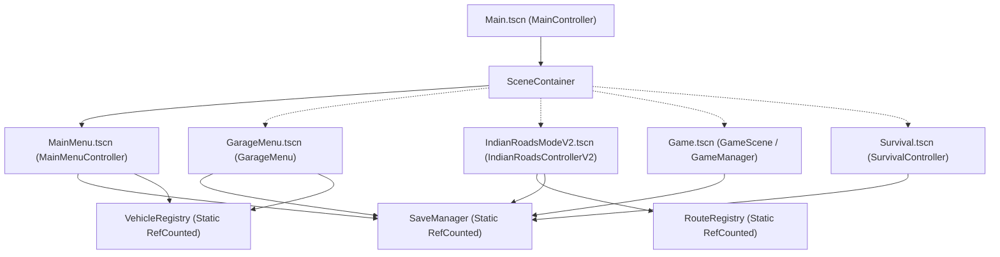

# Hill Climb V2 — Game Architecture Specification V2.0

**Project:** Hill Climb V2  
**Engine:** Godot Engine v4.7.2.stable  
**Subsystem:** Core Engine Architecture, Scene Management & Single Source of Truth  
**Document:** `docs/GAME_ARCHITECTURE_V2.md`  
**Working Branch:** `feature/hill-climb-complete-rebuild`  
**Lead / Author:** Senior Godot 4.7 Gameplay Engineer & Technical Architect  
**Status:** **PHASE 1 IMPLEMENTED & VERIFIED**

---

## 1. Architectural Philosophy & Design Principles

The V2.0 architecture eliminates legacy fragmentations (such as unregistered singletons and parallel save files) in favor of a clean, robust, and unified Godot 4 engine pipeline:

1. **Single Source of Truth:** All persistent state (coins, high scores, unlocked vehicles, upgrade tiers, discovered landmarks, audio volumes) is strictly governed by [SaveManager.gd](file:///home/joel/Documents/game/hill-climb-V2/scripts/core/SaveManager.gd) writing to `user://savegame.json`.
2. **Decoupled Vehicle Contracts:** Vehicles are registered in [VehicleRegistry.gd](file:///home/joel/Documents/game/hill-climb-V2/scripts/vehicle/VehicleRegistry.gd). The Garage, Main Menu carousel, Endless mode, Survival mode, and Indian Roads mode all query `VehicleRegistry` and instantiate via `VehicleRegistry.instantiate_vehicle()`.
3. **Decoupled Route & Milestone Contracts:** Highway routes, distances, checkpoints, and landmarks are registered in [RouteRegistry.gd](file:///home/joel/Documents/game/hill-climb-V2/scripts/modes/indian_roads/RouteRegistry.gd) and [RoadsideLandmarkRegistry.gd](file:///home/joel/Documents/game/hill-climb-V2/scripts/modes/indian_roads/RoadsideLandmarkRegistry.gd) using stable IDs (`LOC-TN-01`, etc.) rather than ad-hoc display strings.
4. **Hierarchical Scene Switching:** [MainController.gd](file:///home/joel/Documents/game/hill-climb-V2/scripts/core/Main.gd) acts as the root orchestrator, hosting exactly one active game mode inside `SceneContainer` to prevent memory leaks and scene cross-talk.

---

## 2. Core Architecture Topology



---

## 3. Scene Navigation & Lifecycle Management

### 3.1 Scene Controller Transitions
[MainController.gd](file:///home/joel/Documents/game/hill-climb-V2/scripts/core/Main.gd) manages scene lifecycle via dedicated transition methods:
- `load_menu()`: Instantiates [MainMenu.tscn](file:///home/joel/Documents/game/hill-climb-V2/scenes/main/MainMenu.tscn).
- `load_garage()`: Instantiates [GarageMenu.tscn](file:///home/joel/Documents/game/hill-climb-V2/scenes/ui/GarageMenu.tscn).
- `load_indian_roads()`: Instantiates [IndianRoadsModeV2.tscn](file:///home/joel/Documents/game/hill-climb-V2/scenes/modes/indian_roads/visual_upgrade_v2/IndianRoadsModeV2.tscn) with `start_with_selection = true`.
- `load_survival()`: Instantiates [Survival.tscn](file:///home/joel/Documents/game/hill-climb-V2/scenes/modes/survival/Survival.tscn) with typed food obstacles and warning indicators.
- `load_game()`: Instantiates [Game.tscn](file:///home/joel/Documents/game/hill-climb-V2/scenes/game/Game.tscn) (Endless Map).

### 3.2 Return-to-Menu Protocol
Every sub-scene exposes a standardized signal `return_to_main_menu_requested` (or `back_pressed`). `MainController` binds this signal to `load_menu()`, guaranteeing that when returning to the menu:
1. Active physics simulations, background audio, and timers in the child scene are queued for deletion (`queue_free()`).
2. Global pause state is unlocked (`get_tree().paused = false`).
3. Memory is reclaimed before instantiating the menu.

---

## 4. Single Source of Truth Data Flow

### 4.1 Persistence Schema (`SaveManager`)
The schema written to `user://savegame.json` is standardized:
```json
{
	"version": 1,
	"best_distance": 0.0,
	"total_coins": 0,
	"runs_played": 0,
	"sound_volume": 1.0,
	"music_volume": 1.0,
	"selected_vehicle_id": "blue_flame_truck",
	"unlocked_vehicles": ["blue_flame_truck"],
	"completed_routes": [],
	"discovered_landmarks": [],
	"vehicle_upgrades": {
		"blue_flame_truck": {"engine": 1, "tires": 1, "suspension": 1, "fuel_tank": 1, "nitro": 1},
		"orc_racer": {"engine": 1, "tires": 1, "suspension": 1, "fuel_tank": 1, "nitro": 1},
		"trophy_truck": {"engine": 1, "tires": 1, "suspension": 1, "fuel_tank": 1, "nitro": 1},
		"dune_buggy": {"engine": 1, "tires": 1, "suspension": 1, "fuel_tank": 1, "nitro": 1}
	}
}
```

### 4.2 Garage Upgrades & In-Game Application
1. Player upgrades a vehicle stat in `GarageMenu` $\to$ calls `SaveManager.upgrade_vehicle_stat(vehicle_id, stat_key)`.
2. When the vehicle is instantiated in any game mode, [VehicleController.gd](file:///home/joel/Documents/game/hill-climb-V2/scripts/vehicle/VehicleController.gd) invokes `_recalculate_upgrades()` in `_ready()`:
   - **Engine:** Scales `motor_torque = base_motor_torque * (1.0 + (level - 1) * 0.15)`
   - **Tires:** Scales `wheel_friction = base_wheel_friction * (1.0 + (level - 1) * 0.12)`
   - **Suspension:** Tightens joint compliance `eff_softness = maxf(0.01, base_suspension_softness - (level - 1) * 0.008)`
   - **Fuel Tank:** Increases `max_fuel = base_max_fuel * (1.0 + (level - 1) * 0.20)`
   - **Nitro:** Increases capacity and recharge rate.

---

## 5. Verification & Test Evidence

The V2 architecture was validated using [tests/test_core_architecture_and_navigation.gd](file:///home/joel/Documents/game/hill-climb-V2/tests/test_core_architecture_and_navigation.gd):
- [x] Initial boot into MainMenu by default.
- [x] MainMenu $\to$ GarageMenu $\to$ MainMenu (verified 4 registered vehicles, stat upgrades, coin spending, vehicle selection).
- [x] MainMenu $\to$ Indian Roads (StateSelection Hub) $\to$ MainMenu (verified interactive map on entry).
- [x] MainMenu $\to$ Survival Mode $\to$ MainMenu (verified 3 lives and food obstacles).
- [x] MainMenu $\to$ Endless Map $\to$ MainMenu (verified clean countryside without snowfall).
- [x] 100% test pass rate with zero runtime crashes.
