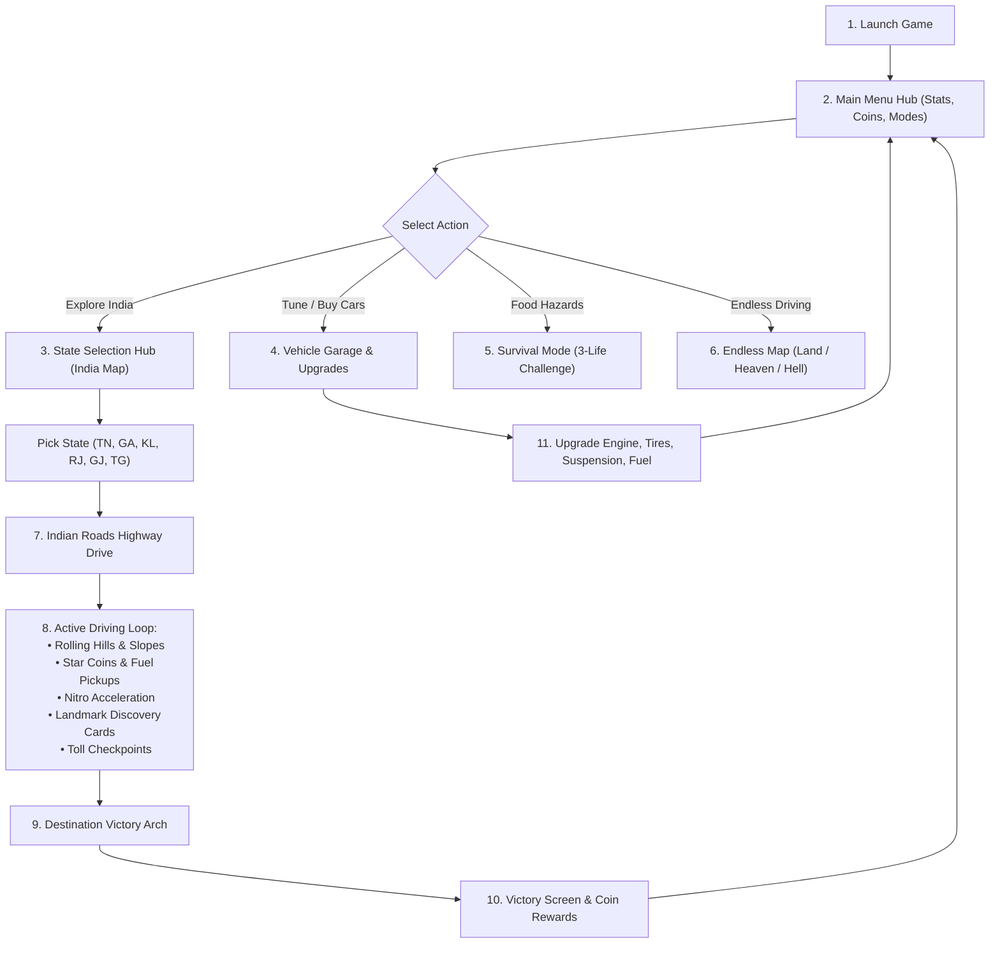

# Hill Climb V2 — Game Design & Player Flow Specification

**Project:** Hill Climb V2  
**Target Platform:** Mobile First (Android Landscape) / Desktop Testing  
**Document:** `docs/GAME_DESIGN_AND_FLOW.md`  
**Working Branch:** `feature/hill-climb-complete-rebuild`  
**Author:** Senior Godot 4.7 Gameplay Engineer & UI/UX Designer  
**Status:** **PHASE 1 IMPLEMENTED & VERIFIED**

---

## 1. Master Player Journey & Core Loop



---

## 2. Detailed Game Modes

### 2.1 Indian Roads (The Hero Mode)
- **Concept:** Exploration of India's cultural geography and landmarks across 6 diverse states.
- **Duration:** 3–5 minutes of active, paced driving per state ($950\text{ m}$ to $1,200\text{ m}$).
- **The Six States:**
  1. **Tamil Nadu ($1,100\text{ m}$):** Kanyakumari $\to$ Chennai via Madurai. Features the restored authentic granite Thiruvalluvar Statue, Kanyakumari Glass Bridge, Gandhi Memorial, Meenakshi Amman Temple, and Marina Beach.
  2. **Goa ($950\text{ m}$):** Panaji $\to$ Margao. Tropical coastal highway, Fontainhas colorful Portuguese cottages, laterite stone walls, Calangute beach road, and Basilica of Bom Jesus.
  3. **Kerala ($1,050\text{ m}$):** Kochi $\to$ Munnar. Monsoon backwaters, Chinese fishing nets, Alleppey houseboats, tea plantation hill curves, and Athirappilly waterfalls.
  4. **Rajasthan ($1,200\text{ m}$):** Jaipur $\to$ Jaisalmer. Thar desert highway, rolling golden sand dunes, Hawa Mahal, Amber Fort, Mehrangarh Fort, and roadside dhabas.
  5. **Gujarat ($1,150\text{ m}$):** Ahmedabad $\to$ Rann of Kutch. White salt desert flats, Sabarmati Ashram, Adalaj Stepwell, Modhera Sun Temple, and Statue of Unity.
  6. **Telangana ($1,000\text{ m}$):** Hyderabad $\to$ Warangal. Deccan rocky plateaus, Charminar, Golconda Fort, and Thousand Pillar Temple.

### 2.2 Vehicle Garage & Progression
- **Vehicles:**
  1. `Blue Flame Truck`: Heavy off-road powerhouse (Unlocked by default).
  2. `Orc Racer`: High-revving wasteland buggy (350 Coins).
  3. `Electric Dune Buggy`: Ultralight tubular roll-cage racer (450 Coins).
  4. `Trophy Truck`: Desert baja racing machine (500 Coins).
- **Stat Upgrades (5 Tiers each):**
  - Engine Torque: Increases hill-climbing acceleration.
  - Off-Road Tires: Enhances tire grip and eliminates wheel slip.
  - Suspension Shocks: Tightens joint compliance and prevents chassis bottoming.
  - Fuel Tank: Extends distance between petrol refills.
  - Nitro Capacity: Increases duration and recharge rate.

### 2.3 Survival Mode
- Dynamic food hazard drops (Chilli, Rice, Sweets, Vada Pav, Samosa).
- Visual billboard warning exclamation mark indicating hazard trajectories.
- 3-life system with hit debouncing and escalating drop rates.

### 2.4 Endless Map Mode
- Endless distance challenge across rolling countryside with jump ramps and coin trails.
- Procedural segment pooling with seamless physics transitions.

---

## 3. UI/UX & Mobile Touch Control Architecture

The mobile HUD is designed for landscape smartphone displays ($1280 \times 720$ base viewport, scale-ready up to $2560 \times 1440$):

```
+-------------------------------------------------------------------------+
| [PAUSE]   DIST: 350m / 1100m   NEXT: MADURAI CHECKPOINT (185m)    [MAP] |
|                                COINS: 120    FUEL: [||||||||  ]         |
|                                                                         |
|                                                                         |
|                                                                         |
|                                                                         |
|  [NITRO]                                                      [ GAS ]   |
|  [BRAKE]                                                                |
+-------------------------------------------------------------------------+
|        LANDMARK DISCOVERY CARD: THIRUVALLUVAR STATUE (133 FT)           |
+-------------------------------------------------------------------------+
```

### Ergonomics & Safe Zones:
- **Left Thumb Zone:** 
  - `Brake / Reverse` button ($140 \times 100\text{ px}$) at bottom left.
  - `Nitro Boost` button ($120 \times 80\text{ px}$) positioned directly above the Brake button on the left side for natural thumb sliding.
- **Right Thumb Zone:**
  - `Gas / Accelerate` button ($140 \times 120\text{ px}$) at bottom right.
- **Top Corners:**
  - `Pause [||]` button at top-left.
  - `Route Map [MAP]` button at top-right.
- **Bottom Center:**
  - `Landmark Information Card` ($580 \times 160\text{ px}$) centered at bottom with $> 180\text{ px}$ horizontal margin from touch controls, completely preventing accidental touches.

---

## 4. Economy & Pacing Calibration

| Action / Milestone | Coin Reward | Economy Impact |
|---|:---:|---|
| Roadside Star Coin | $+10\text{--}20$ | Frequent micro-rewards along road dips and jump crests. |
| Checkpoint Cleared | $+50\text{--}150$ | Mid-route milestone achievement. |
| Landmark Discovery | $+50\text{--}100$ | Encourages cultural tourism exploration. |
| Route Destination Victory | $+350\text{--}500$ | Major payoff for completing the 3–5 min state journey. |
| Stat Upgrade Tier 1 $\to$ 2 | $-50$ | Accessible after first casual run. |
| Stat Upgrade Tier 2 $\to$ 3 | $-120$ | Accessible after 1 state route completion. |
| Stat Upgrade Tier 3 $\to$ 4 | $-250$ | Mid-tier investment. |
| Stat Upgrade Tier 4 $\to$ 5 | $-500$ | End-game mastery payoff. |
| Vehicle Unlock (Orc Racer) | $-350$ | Achievable after completing 1 state. |
| Vehicle Unlock (Trophy Truck) | $-500$ | Achievable after completing 2 states. |
