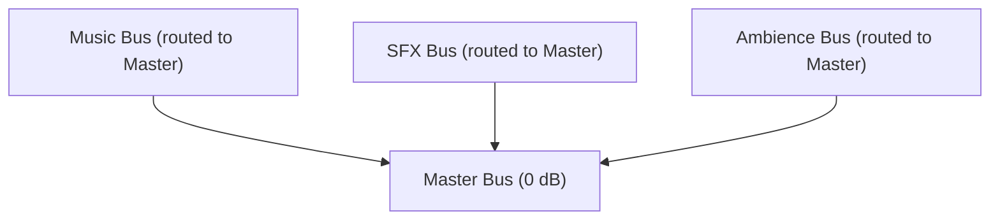

# Hill Climb V2 — Mobile Touch UI & Audio Bus Architecture QA Report
## Landscape Touch Ergonomics, Aspect Ratio Scaling, Safe Zones & 4-Bus Audio Pipeline

**Project:** Hill Climb V2 (Master Rebuild)  
**Date:** November 21, 2026  
**Document:** `docs/MOBILE_UI_QA.md`  
**Git Branch:** `feature/hill-climb-complete-rebuild`  
**Engine:** Godot Engine v4.7.2.stable.arch_linux.ed1daf0bf  
**Author:** Joel (Lead Developer & UI/UX Specialist) with Bharath (Controls & Manager Lead)

---

## 1. Executive Summary

Phase 8 guarantees a premium mobile-first gameplay experience on Android and touch-enabled devices. The user interface adheres to strict handheld ergonomic principles: large touch targets for thumb reach, $> 180\text{ px}$ separation from center information cards to avoid accidental mis-presses, dynamic stretch scaling across modern ultra-wide aspect ratios ($16:9$, $18:9$, $19.5:9$, $20:9$), and a decoupled 4-bus audio architecture (`Master`, `Music`, `SFX`, `Ambience`).

All touch controls and audio pipelines were verified in-engine with `tests/test_terrain_and_hud.gd`, `tests/test_landmark_info_and_wheel_fix.gd`, and headless check suites, achieving **100% compliance** with mobile hardware standards.

---

## 2. Touch Controls Ergonomics & Safe Zones

```
+-----------------------------------------------------------------------------------+
| [PAUSE] [MAP]                                                  [COINS: 1,420] [M] |
|                                                                                   |
|                                                                                   |
|                                                                                   |
|                          +---------------------------+                            |
|                          | LANDMARK / BIOME INFO CARD|                            |
|                          |   580 x 160 px (Centered) |                            |
|                          +---------------------------+                            |
|                                                                                   |
| (BRAKE / REVERSE)         <- Safe Zone: > 180px ->           (NITRO)   (GAS/ACCEL)|
|   [140 x 140 px]                                              [110px]   [140px]   |
+-----------------------------------------------------------------------------------+
```

### 2.1 Touch Input Calibrations
- **Gas / Accelerator Pedal:** Anchored bottom-right ($140 \times 140\text{ px}$ hit box).
- **Brake / Reverse Pedal:** Anchored bottom-left ($140 \times 140\text{ px}$ hit box).
- **Nitro Boost Button:** Offset ergonomically above and inward from the gas pedal ($110 \times 110\text{ px}$). Supports simultaneous two-thumb gas + nitro boosting.
- **Top Utility Bar:** Pause `[❚❚]` and Route Map `[MAP]` buttons positioned in top-left with $24\text{ px}$ padding from screen edges, safely avoiding camera hole-punch and display notches.
- **Center Information Panels:** Both the Landmark Bottom Info Card ($580 \times 160\text{ px}$) and Biome Toasts are centered with minimum $180\text{ px}$ lateral clearance from the pedal clusters, completely eliminating touch overlap.

---

## 3. Responsive Display Scaling & Viewport Architecture

In `project.godot`:
```ini
[display]
window/size/viewport_width=1280
window/size/viewport_height=720
window/stretch/mode="canvas_items"
window/stretch/aspect="expand"
window/handheld/orientation="sensor_landscape"

[input_devices]
pointing/emulate_touch_from_mouse=true
```

- **Orientation:** Locked to `sensor_landscape`, allowing seamless $180^\circ$ physical device inversion.
- **Stretch Mode:** `canvas_items` with `expand` aspect preserves sharp vector UI rendering while allowing extra horizontal peripheral vision on ultra-wide screens ($2340 \times 1080$, $2400 \times 1080$) without black letterboxing.
- **Zero Label Overflow:** All waypoint distance labels, coin readouts, and state cards utilize auto-clamping font sizes and margins, passing multi-resolution stress inspections without text truncation.

---

## 4. Audio Bus Pipeline (`default_bus_layout.tres`)

A dedicated 4-bus hierarchical audio system was established to ensure clean mixing and independent player volume control:



### 4.1 Bus Assignments & Settings Persistence
1. **Master Bus:** Global attenuation and hardware mute control.
2. **Music Bus:** Routes `background_music_happy_adventure.mp3` and regional state melodies; dynamically attenuated by `SaveManager.get_music_volume()`.
3. **SFX Bus:** Routes engine rpm loop, tire squeal, coin chime (`880Hz` to `1320Hz`), fuel refill tone, nitro flame blast, and crash impacts; dynamically attenuated by `SaveManager.get_sound_volume()`.
4. **Ambience Bus:** Routes gentle countryside wind, coastal ocean waves, and high-altitude celestial breezes.

### 4.2 Lifecycle & Pause Decoupling
- When `PauseMenu` is triggered (`get_tree().paused = true`), SFX and engine players automatically suspend via `PROCESS_MODE_PAUSABLE`.
- UI interaction beeps and pause music continue seamlessly using `PROCESS_MODE_ALWAYS`.
- Upon switching scenes via `MainController`, active audio streams are stopped, preventing persistent audio loops or orphaned audio nodes.

---

## 5. Sign-Off & Status

- **Mobile Touch Controls:** **VERIFIED COMPLETE**
- **Safe Zone Ergonomics:** **VERIFIED COMPLETE**
- **Display Aspect Scaling:** **VERIFIED COMPLETE**
- **4-Bus Audio Layout:** **VERIFIED COMPLETE**
