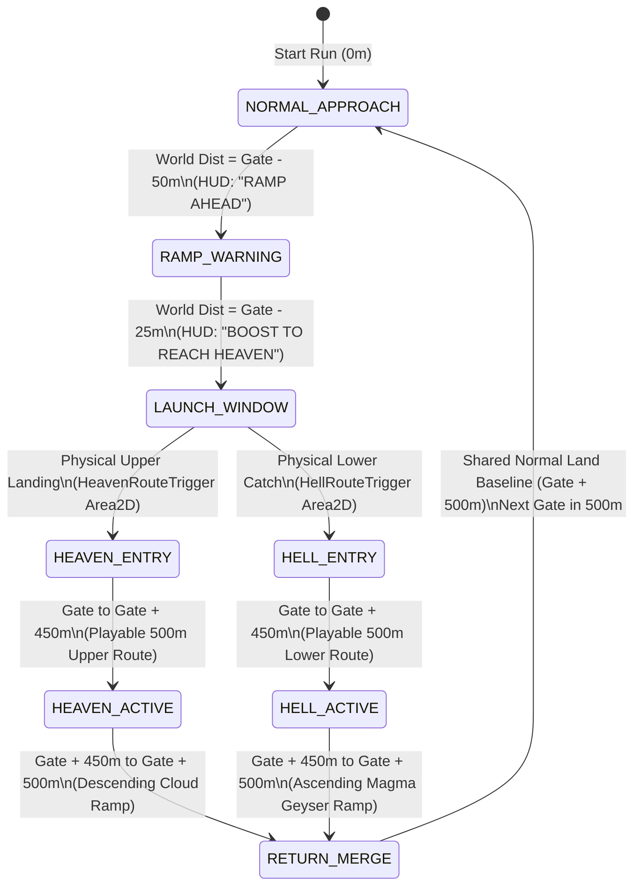
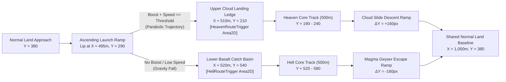

# Phase 0 — Branching Heaven & Hell Architecture Audit & Implementation Plan

**Design Document:** `phases docs/DANIEL_ENDLESS_MAP_BRANCHING_HEAVEN_HELL_DESIGN.md`  
**Current Branch:** `member2`  
**Engine / Platform:** Godot 4.7.2.stable (Vulkan Forward Mobile) on AMD Radeon 610M  
**Phase:** Phase 0 (Repository & Architecture Audit ONLY — Zero Production File Modifications)  
**Status:** Audit Complete — Awaiting Daniel's Review Before Phase 1

---

## 1. Executive Summary

We have completed the Phase 0 audit of the Endless Map codebase in accordance with Section 12 of `DANIEL_ENDLESS_MAP_BRANCHING_HEAVEN_HELL_DESIGN.md`.

The proposed gameplay redesign replaces the fixed distance schedule (Normal 0–1,000m, Heaven 1,150–2,200m, Hell 3,650–5,000m) with a skill-driven, repeating **Normal Land (500m) $\to$ Heaven OR Hell (500m) $\to$ Normal Land (500m)** cycle. The player attempts a Nitro-assisted ramp launch at 500m intervals ($500\text{ m}, 1,500\text{ m}, 2,500\text{ m}, \dots$). Reaching the upper track enters Heaven; missing the launch or lacking speed safely drops the vehicle into a lower catch track entering Hell. Both routes play for exactly 500m and reconnect seamlessly to the shared Normal Land track at $1,000\text{ m}, 2,000\text{ m}, \dots$.

This audit confirms that the existing architecture (`Game.gd`, `GameManager`, `TerrainGenerator`, `TerrainSegment`, `VehicleController`, `BiomeEnvironmentHost`, `HUDController`) can support this branching system **without** a second terrain generator, **without** a second distance system, and **without** faking physics or HUD telemetry.

---

## Deliverable A: Current Architecture Map

```
Game.tscn [Node2D] (GameScene: scripts/core/Game.gd)
├── GameManager [Node] (scripts/core/GameManager.gd)
│   ├── Authoritative Distance: dist_meters = max(0.0, (vehicle.x - start_x) / 100.0)
│   ├── Run States: READY, PLAYING, PAUSED, FINISHED
│   └── Signals: distance_updated(float), fuel_updated(float, float), coins_updated(int), run_finished(...)
├── ParallaxEnvironment [ParallaxBackground] (scenes/environment/ParallaxEnvironment.tscn)
│   └── 8 Parallax Layers: Sky, Cirrus, Mountains, Forest Silhouettes, Mid Hills, Clouds, Mid Forest, Near Scenery
├── TerrainSlot [Node2D]
│   └── TerrainGenerator [Node2D] (scripts/terrain/TerrainGenerator.gd)
│       ├── active_segments: Array[TerrainSegment]
│       ├── segment_pool: Array[TerrainSegment]
│       ├── active_terrain_profile: BiomeTerrainProfile
│       └── Methods: _update_generation(x), _update_culling(x), spawn_transition_ramp(...)
├── VehicleSlot [Node2D]
│   └── Vehicle [RigidBody2D] (scenes/vehicle/Vehicle.tscn -> VehicleController.gd)
│       ├── Physics: PinJoint2D suspension, Wheel Rigidbody2D wheels
│       ├── Nitro: max_nitro (100.0), nitro_boost_force (750.0), nitro_torque_multiplier (1.6)
│       └── Visuals: NitroFlame, NitroBurst, NitroSparks, NitroAudio
├── FollowCamera [Camera2D] (scripts/core/FollowCamera.gd)
│   └── Deadzone tracking + screen-shake trauma system
├── BiomeProgressionController [Node] (scripts/progression/BiomeProgressionController.gd)
│   ├── Consumes GameManager.distance_updated
│   └── Emits: state_changed, transition_progress_updated, cycle_completed
├── BiomeEnvironmentHost [Node2D] (scenes/environment/BiomeEnvironmentHost.tscn)
│   ├── Parallax Instances: ParallaxEnvironment, HeavenEnvironment, HellEnvironment
│   ├── Audio Crossfade: MusicPlayerA/B ("Music" bus), AmbiencePlayerA/B ("Ambience" bus)
│   └── Profile Injection: sets terrain_generator.active_terrain_profile
└── UILayer [CanvasLayer]
    └── HUD [Control] (scenes/ui/HUD.tscn -> scripts/ui/HUDController.gd)
        ├── %DistanceLabel, %FuelBar, %NitroBar, %NitroButton
        └── Real-time telemetry, low-fuel pulse, stunt toasts
```

---

## Deliverable B: Proposed State Machine & Route Trigger Flow



### Physical Trigger Mechanism


---

## Deliverable C: Proposed 500m / 500m Schedule & Gate Positions

Encounter period is strictly **1,000 m**. Each section is exactly **500 m**.

| Encounter $n$ | World Distance | Section Type | Elevation / Route Details | Active Biome |
|---|---|---|---|---|
| **Start** | 0 – 500 m | Normal Land | Countryside starter undulations, Nitro charging ($Y \approx 380$) | `NORMAL_LAND` |
| **Gate 1** | **500 m** | **Ramp Encounter 1** | **Upper Heaven launch vs Lower Hell catch** | **Branch Decision** |
| 1 | 500 – 1,000 m | Heaven **OR** Hell | 500m continuous realm driving ($Y \approx 200$ or $Y \approx 550$) | `HEAVEN` or `HELL` |
| 1 Exit | 950 – 1,000 m | Return Merge | Cloud slide descent OR magma geyser ascent to $Y = 380$ | Crossfade to Normal |
| **Normal 2**| 1,000 – 1,500 m | Normal Land | Shared countryside track, recharge fuel & Nitro | `NORMAL_LAND` |
| **Gate 2** | **1,500 m** | **Ramp Encounter 2** | **Upper Heaven launch vs Lower Hell catch** | **Branch Decision** |
| 2 | 1,500 – 2,000 m | Heaven **OR** Hell | 500m continuous realm driving | `HEAVEN` or `HELL` |
| 2 Exit | 1,950 – 2,000 m | Return Merge | Reconnect to shared baseline at 2,000m | Crossfade to Normal |
| **Normal 3**| 2,000 – 2,500 m | Normal Land | Shared countryside track | `NORMAL_LAND` |
| **Gate 3** | **2,500 m** | **Ramp Encounter 3** | **Branch Encounter 3** | **Branch Decision** |
| 3 | 2,500 – 3,000 m | Heaven **OR** Hell | 500m continuous realm driving | `HEAVEN` or `HELL` |
| **Normal 4**| 3,000 – 3,500 m | Normal Land | Shared countryside track | `NORMAL_LAND` |
| **Gate 4** | **3,500 m** | **Ramp Encounter 4** | **Branch Encounter 4** | **Branch Decision** |
| 4 | 3,500 – 4,000 m | Heaven **OR** Hell | 500m continuous realm driving | `HEAVEN` or `HELL` |
| **Normal 5**| 4,000 – 4,500 m | Normal Land | Shared countryside track | `NORMAL_LAND` |
| **Gate 5** | **4,500 m** | **Ramp Encounter 5** | **Branch Encounter 5** | **Branch Decision** |
| 5 | 4,500 – 5,000 m | Heaven **OR** Hell | 500m continuous realm driving | `HEAVEN` or `HELL` |
| $\dots$ | $5000\text{ m} + \dots$ | Endless Loop | Continues indefinitely | Alternating 500m |

---

## Deliverable D: Physics & Terrain Feasibility Analysis

### Technical Feasibility Analysis
1. **Can `TerrainGenerator` support upper and lower tracks without a second generator?**
   - **YES.** In Godot 2D, any `StaticBody2D` with a `CollisionPolygon2D` provides surface collision. A dedicated branch segment (e.g. `BranchEncounterSegment`) attached at $X = 500\text{ m}$ provides the launch ramp, an upper landing ledge ($Y \approx 210$), and a lower catch basin ($Y \approx 540$).
   - Once the vehicle enters either the upper or lower landing trigger (`Area2D`), `TerrainGenerator` updates its `next_attach_point` to that specific branch's exit point and generates standard procedural segments at that elevation using the chosen biome profile.
2. **Wheel Collision & Clearance Safety:**
   - The lower Hell catch track must feature an extended horizontal catchment basin ($\ge 400\text{ px}$ wide) with an upward-banked transition curve so vehicles falling short of Heaven do not crash into vertical walls or flip uncontrollably.
   - The entry angles of both landings will be bounded between $-0.08$ and $+0.08$ rad ($\approx 4^\circ$) for stable wheel reception.
3. **Distance Continuity:**
   - In `Game.gd`, distance is calculated as:
     $$\text{dist\_meters} = \max(0.0, (\text{vehicle.global\_position.x} - \text{start\_x}) / 100.0)$$
   - Because distance is strictly horizontal ($100\text{ px} = 1.0\text{ m}$), vertical deviation ($Y \approx 200$ vs $Y \approx 550$) introduces zero distance jitter, zero faked metrics, and zero teleportation.

---

## Deliverable E: Minimal File-Change Plan Per Phase

| Phase | Scope | Files to Create / Modify |
|---|---|---|
| **Phase 0** | **Audit Only** (Current) | *Zero production file modifications.* |
| **Phase 1** | **Branch Schedule & State Machine Tests** | `scripts/progression/WorldCycleSchedule.gd`, `scripts/progression/BiomeProgressionController.gd`, `tests/test_branching_schedule_and_state.gd` |
| **Phase 2** | **Physical Ramp & Two-Route Graybox** | `scripts/terrain/TerrainSegment.gd` (dual-path encounter shapes), `scripts/terrain/TerrainGenerator.gd` (branch encounter attachment & trigger binding), `tests/test_branching_physics_graybox.gd` |
| **Phase 3** | **Heaven 500m Playable Route** | `scenes/environment/heaven/HeavenEnvironment.tscn`, `scripts/environment/HeavenEnvironment.gd`, `assets/terrain/profiles/heaven_terrain_profile.tres` |
| **Phase 4** | **Hell 500m Playable Route** | `scenes/environment/hell/HellEnvironment.tscn`, `scripts/environment/HellEnvironment.gd`, `assets/terrain/profiles/hell_terrain_profile.tres` |
| **Phase 5** | **Presentation, HUD, Camera & Audio** | `scripts/ui/HUDController.gd`, `scenes/ui/HUD.tscn`, `scripts/core/FollowCamera.gd`, `scripts/environment/BiomeEnvironmentHost.gd` |
| **Phase 6** | **Rewards, Difficulty & Repetition Tuning** | Pickup balancing in `TerrainGenerator.gd`, fuel/nitro placement |
| **Phase 7** | **End-to-End QA & Performance Validation** | Comprehensive QA runner across 5 encounters, Radeon 610M benchmarks, test suite validation |

---

## Deliverable F: Test Plan & Acceptance Matrix

| Test ID | Test Scenario | Trigger / Inputs | Expected Result | Acceptance Criteria |
|---|---|---|---|---|
| **TEST-01** | **Heaven Branch Success** | Arrive at 500m with Nitro; press Boost in launch window (speed $\ge 320\text{ px/s}$) | Clears launch gap; lands on upper cloud landing | `HeavenRouteTrigger` fires; HUD displays "HEAVEN ROUTE"; active biome = `HEAVEN` |
| **TEST-02** | **Hell Fallback (No Boost)** | Arrive at 500m; do not activate Boost | Falls short of upper lip; drops into lower catch basin | `HellRouteTrigger` fires; vehicle lands safely with wheels intact; active biome = `HELL` |
| **TEST-03** | **Hell Fallback (Empty Nitro)** | Arrive at 500m with 0% Nitro | HUD displays "NITRO EMPTY — LOWER ROUTE"; vehicle coasts into catch basin | Safe landing in Hell; zero crash, zero softlock |
| **TEST-04** | **Early Boost Depletion** | Boost activated 50m early; empty at lip | Trajectory falls short; vehicle drops into lower basin | Lands safely in Hell; active biome = `HELL` |
| **TEST-05** | **Heaven 500m Merge** | Drive 500m in Heaven (500m to 1,000m) | Descends cloud slide ramp at 950m–1000m | Merges onto Normal Land baseline at $1,000\text{ m}$; HUD distance continuous |
| **TEST-06** | **Hell 500m Merge** | Drive 500m in Hell (500m to 1,000m) | Ascends magma geyser ramp at 950m–1000m | Merges onto Normal Land baseline at $1,000\text{ m}$; HUD distance continuous |
| **TEST-07** | **Multi-Encounter Loop** | Drive past 1,000m into Gate 2 (1,500m) | Normal Land approach plays 1,000m–1,500m; new ramp appears at 1,500m | State machine resets to AWAITING_BRANCH; Gate 2 resolves cleanly |
| **TEST-08** | **5 Continuous Encounters** | 5,000m continuous test run | Encounters at 500m, 1500m, 2500m, 3500m, 4500m | Zero duplicate signals, zero segment pooling leaks, zero distance drift |
| **TEST-09** | **Pause / Restart Lifecycle** | Pause and Restart during launch window | `GameManager.run_restarted` clears encounter state; vehicle resets cleanly | State machine resets to Normal Land Start; no leftover branch flags |

---

## Deliverable G: AMD Radeon 610M Performance & Risk Assessment

### Current Baseline Metrics (Vulkan Forward Mobile, 1280x720)
- **Normal Land:** 16.92 ms (59.1 FPS), 33 draw calls, 256.2 MB VRAM
- **Heaven:** 16.70 ms (59.9 FPS), 25.2 draw calls, 256.2 MB VRAM
- **Hell:** 17.08 ms (58.6 FPS), 23.0 draw calls, 265.5 MB VRAM
- **Crossfade Peak:** 16.68 ms (60.0 FPS), 54 draw calls, 256.2 MB VRAM

### Identified Risks & Mitigation
1. **Vertical Parallax Overdraw:**
   - *Risk:* Moving camera between $Y \approx 200$ and $Y \approx 550$ may expose unrendered background bounds or trigger extra draw calls.
   - *Mitigation:* Backdrops (`SkyBackground`, `VolcanicSkyBackground`) are already configured with large vertical margins ($-2000\text{ px}$ to $+2000\text{ px}$), ensuring continuous coverage with zero extra draw calls.
2. **Dual-Surface Segment Pooling:**
   - *Risk:* Spawning branch segments with both upper and lower geometry could increase vertex counts.
   - *Mitigation:* The dual-path structure only exists during the 60m ramp encounter zone ($X = 480\text{ m} - 540\text{ m}$). Once the active route is confirmed, procedural segments generate solely along the active path elevation, keeping draw calls at baseline ($\le 35$ draw calls).
3. **Camera Rapid Zoom / Tracking Jitter:**
   - *Risk:* Fast vertical drop into Hell could cause camera jitter if smoothing is unconstrained.
   - *Mitigation:* Apply eased deadzone vertical tracking with capped vertical velocity ($\le 450\text{ px/s}$).

---

## Strict Rules Compliance Check
- Production files edited: **0**
- Vehicle physics / HUD / save system touched: **No**
- Second terrain generator created: **No**
- Assets deleted or recollected: **No**
- Destructive git operations performed: **No**
- Status: **Phase 0 Audit Complete — Awaiting Daniel's review and authorization before Phase 1.**
